## Phase 1 — Create the frontend app registration

### Step 1: Open Microsoft Entra admin center

1. Open Microsoft Entra admin center.

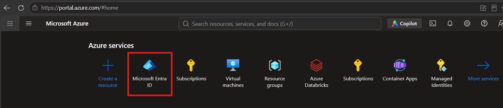

2. Click on App registrations

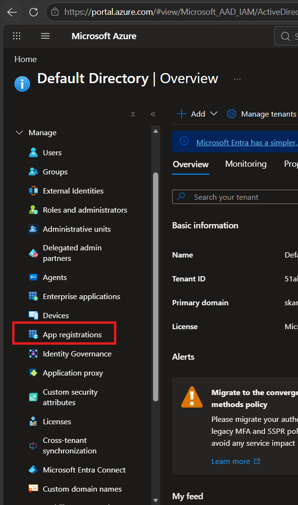

3. Select New registration.

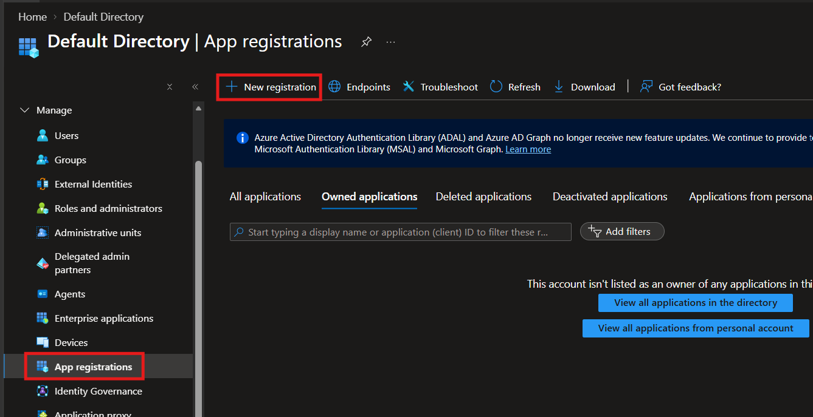

4. Name it **AKS Platform Upgrade Agent UI**.

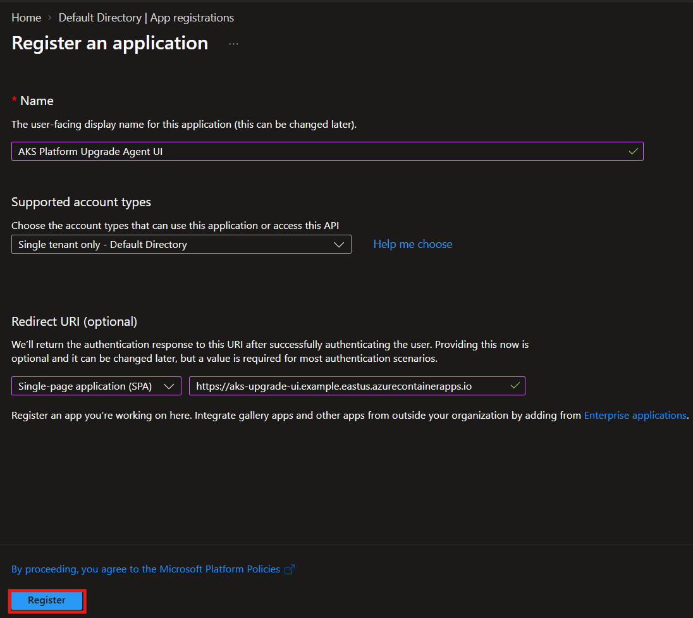

Enter these values:

| Setting                   | Value                                   |
|---------------------------|-----------------------------------------|
| Name                      | AKS Platform Upgrade Agent UI           |
| Supported account types   | Single tenant only - Default Directory  |
| Redirect URI platform     | Single-page application (SPA)           |
| Redirect URI              | Your frontend URL                       |

For example, your deployed frontend might use:

https://aks-upgrade-ui.example.eastus.azurecontainerapps.io

Replace the example with the actual Container Apps URL.

## Step 2: Record the IDs

On the registration's Overview page, copy these values:

| Entra field               | Frontend variable     |
|---------------------------|-----------------------|
| Application (client) ID   | VITE_ENTRA_CLIENT_ID  |
| Directory (tenant) ID     | VITE_ENTRA_TENANT_ID  |

Keep the values available for the next steps.

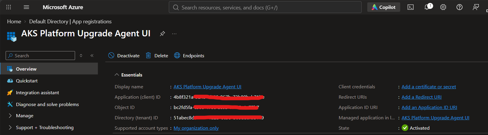


**Important**: The frontend client ID belongs to the frontend app registration. Do not substitute the backend API client ID.

if you don't select **Redirect URI** while creating the app, after register also we can add url

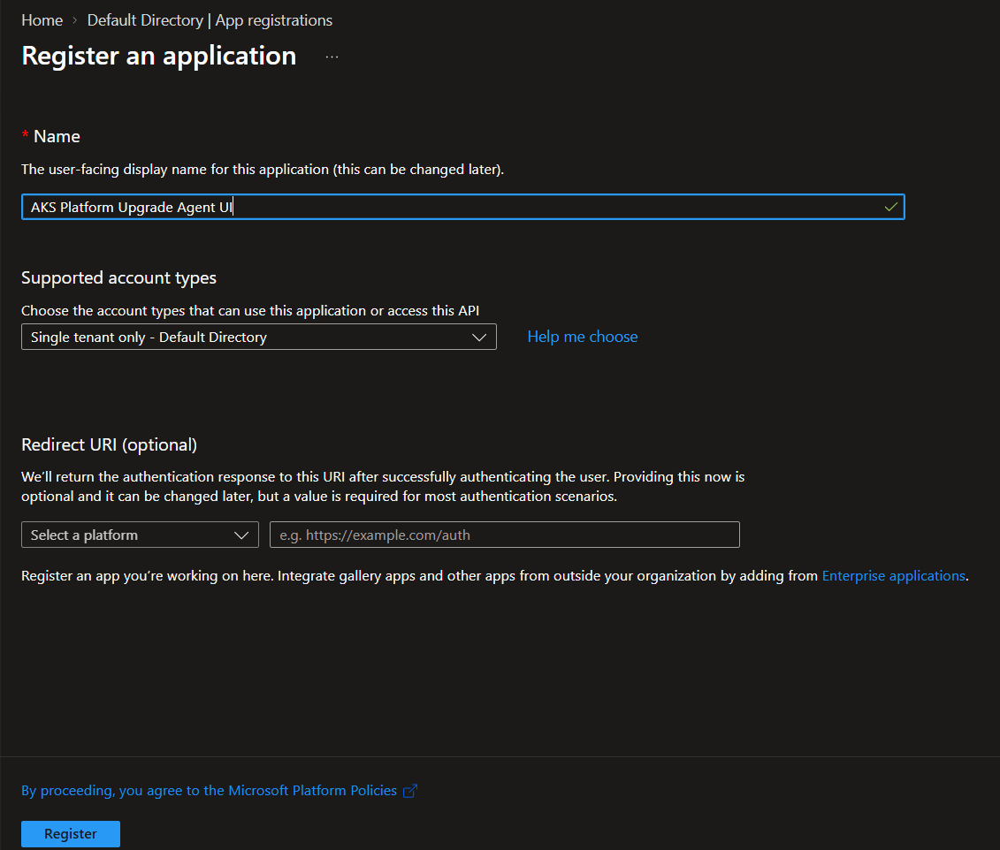

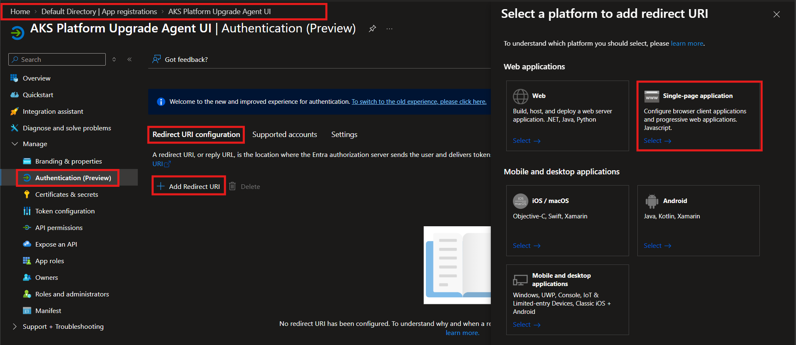

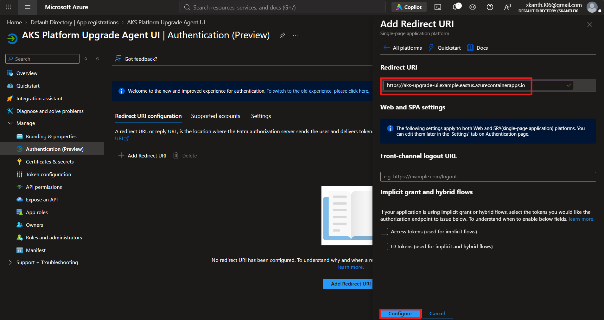

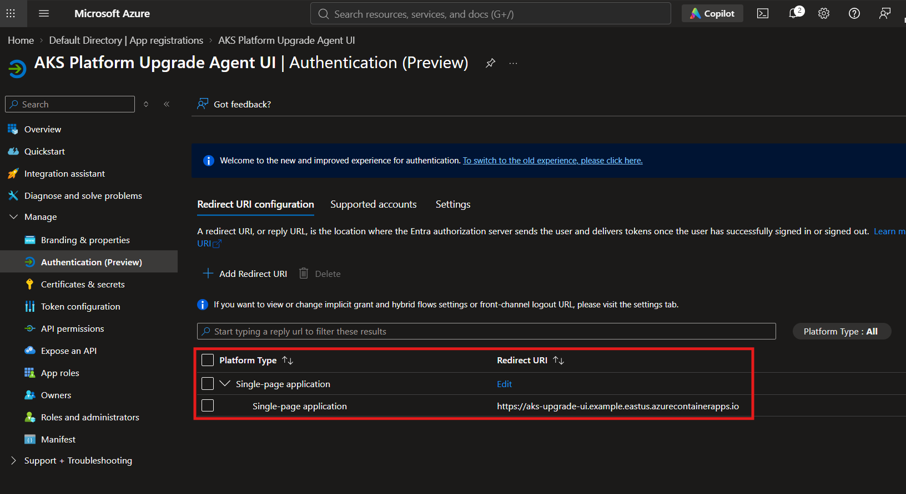


-----------------------------------------------------------------------------

### MSAL implementation

Your repository uses these files:

* frontend/src/auth.ts

* frontend/src/main.tsx

* frontend/src/api.ts

* frontend/Dockerfile

## Step 1: Check frontend/src/auth.ts

The authentication configuration should use the frontend's tenant and client IDs:

```
import {
  Configuration,
  PublicClientApplication,
} from "@azure/msal-browser";

const tenantId = import.meta.env.VITE_ENTRA_TENANT_ID as string;
const clientId = import.meta.env.VITE_ENTRA_CLIENT_ID as string;

export const apiScope = import.meta.env.VITE_API_SCOPE as string;

export const msalConfig: Configuration = {
  auth: {
    clientId,
    authority: `https://login.microsoftonline.com/${tenantId}`,
    redirectUri: window.location.origin,
    postLogoutRedirectUri: window.location.origin,
  },
  cache: {
    cacheLocation: "sessionStorage",
  },
};

export const msalInstance = new PublicClientApplication(msalConfig);
```

The redirect URI should match the origin registered in Entra ID.

## Step 2: Check frontend/src/main.tsx

The application should initialize MSAL and process the redirect response before rendering the React application.

current implementation already initializes MSAL and calls handleRedirectPromise(). Confirm that it also handles the returned account correctly.

-----------------------------------------------------------------------------

### Phase 2 — Create the backend app registration

## Step 1: Register the backend API

1. Open Microsoft Entra admin center → App registrations.

2. Select New registration.

3. Name it **AKS Platform Upgrade Agent API**.

4. Select single-tenant accounts.

5. Register it without a browser redirect URI.

6. Copy its Application (client) ID and the tenant ID.

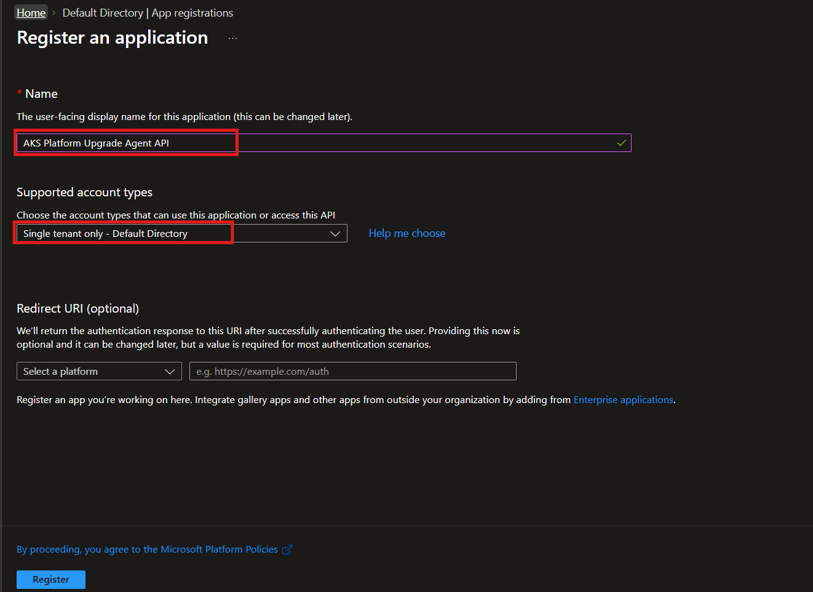

## Step 2: Expose the API scope

1. Open the backend API app registration.

2. Select Expose an API.

3. Set the Application ID URI to: api://<BACKEND_API_CLIENT_ID>

4. Add a delegated scope with the name: AKS.Upgrade

5. Configure the scope's consent and user-consent settings according to your organization's policy.

6. Save.


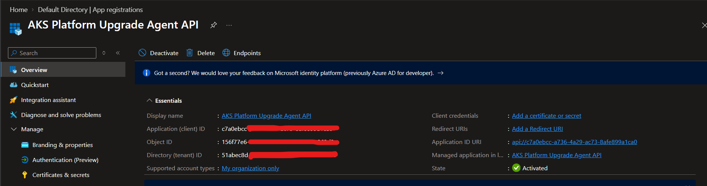


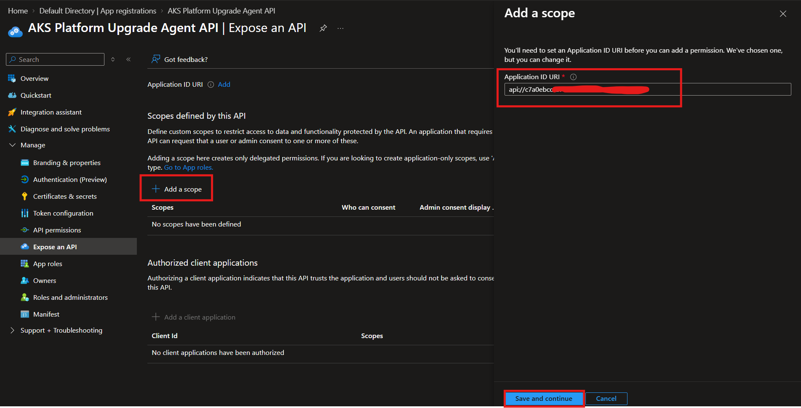


The full scope identifier should look like:

api://<BACKEND_API_CLIENT_ID>/AKS.Upgrade


| Field                     | Value                                                   |
|---------------------------|---------------------------------------------------------|
| Scope name                | AKS.Upgrade                                             |
| Who can consent?          | Admins and users                                        |
| Admin consent display name| Access AKS Upgrade API                                  |
| Admin consent description | Allows the application to access AKS upgrade operations |
| User consent display name | Access AKS Upgrade API                                  |
| User consent description  | Allows the application to access AKS upgrade operations |
| State                     | Enabled                                                 |


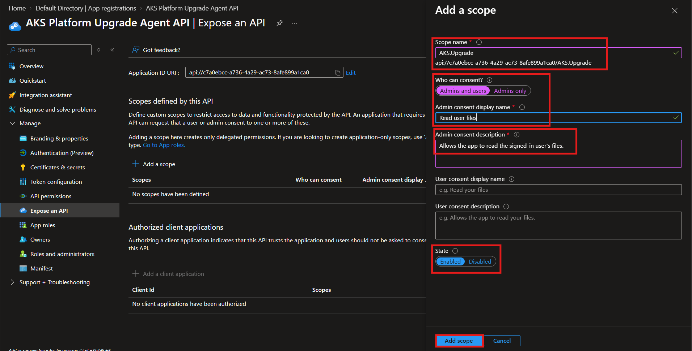


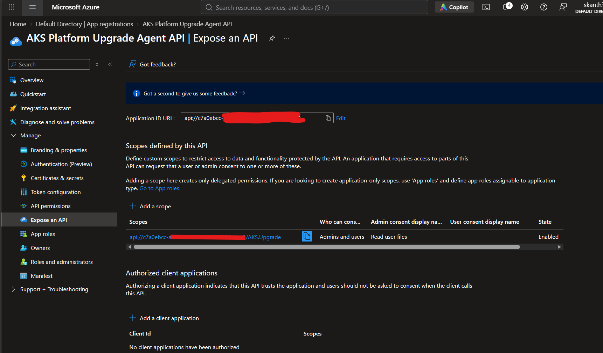


## Step 3: Create the API application role

In the backend API app registration, open App roles and create a role with values such as:

| Field                   | Value                 |
|-------------------------|-----------------------|
| Display name            | VITE_ENTRA_CLIENT_ID  |
| Allowed member types    | VITE_ENTRA_TENANT_ID  |
| Value                   | AKS.Upgrade.Operator  |
| Enabled                 | Yes                   |


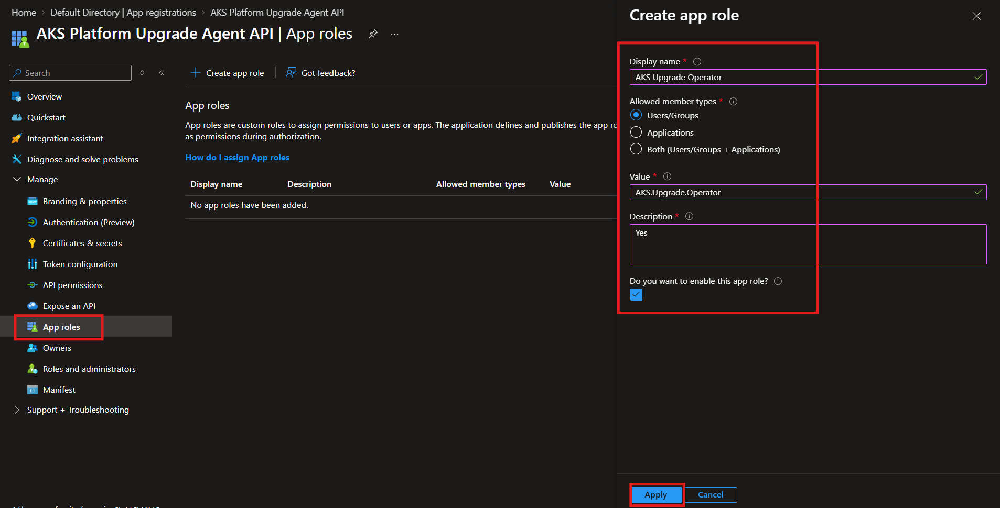


## Step 4: Grant the frontend permission to call the API

1. Open the frontend app registration.

2. Go to API permissions.

3. Select Add a permission → My APIs.

4. Select AKS Platform Upgrade Agent API.

5. Select Delegated permissions.

6. Select AKS.Upgrade.

7. Add the permission.

8. Grant admin consent if required by your organization's policy.

If the API doesn't appear, confirm that the API registration and frontend registration are in the same tenant, that the API scope was exposed successfully, and that the correct tenant is selected in the portal.


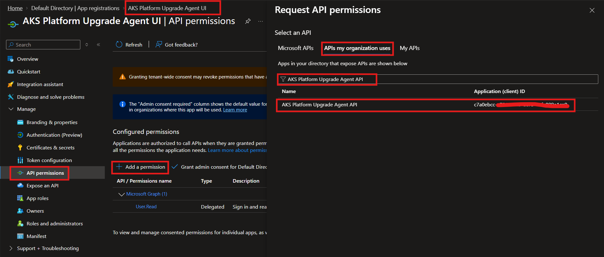


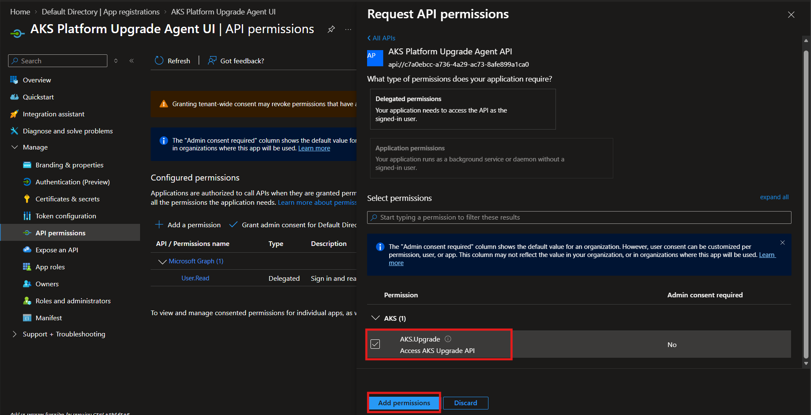


## Step 5:Assign the application role

In the Entra admin center:

1. Open Enterprise applications.

2. Open the service principal for AKS Platform Upgrade Agent API.

3. Select Users and groups.

4. Add the user or group that should operate the upgrade agent.

5. Assign the AKS Upgrade Operator role.

Follow your organization's approval and least-privilege policies.


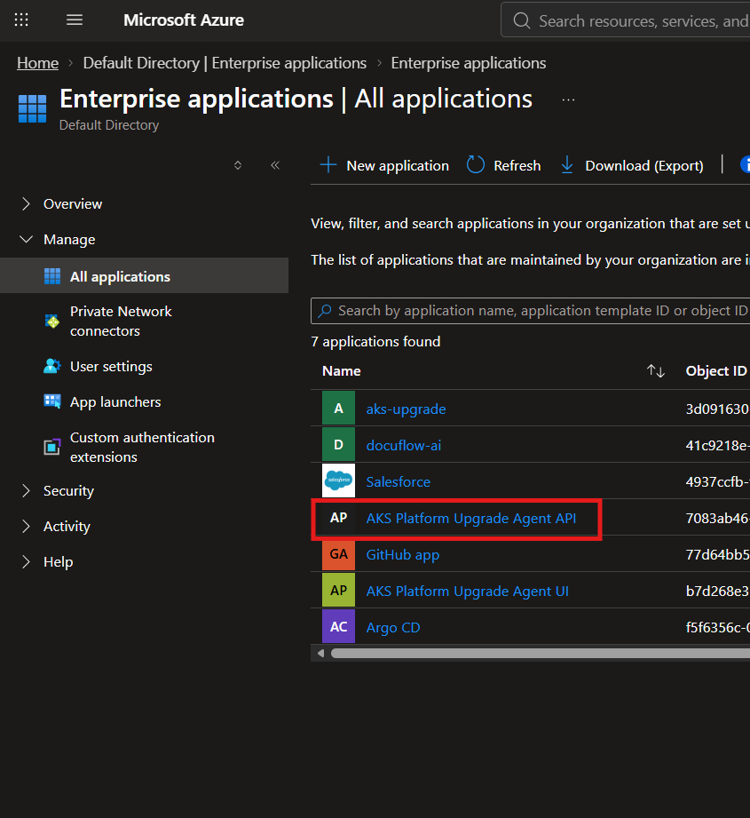


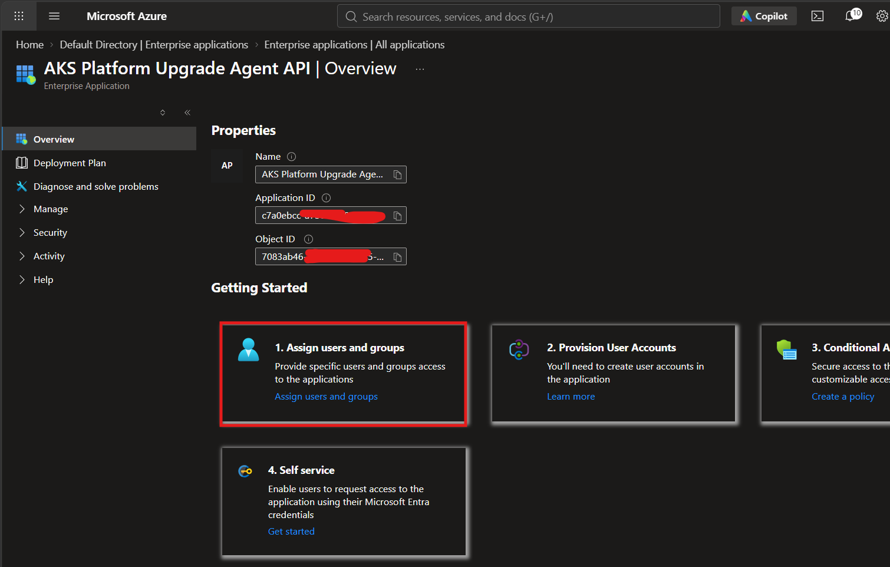


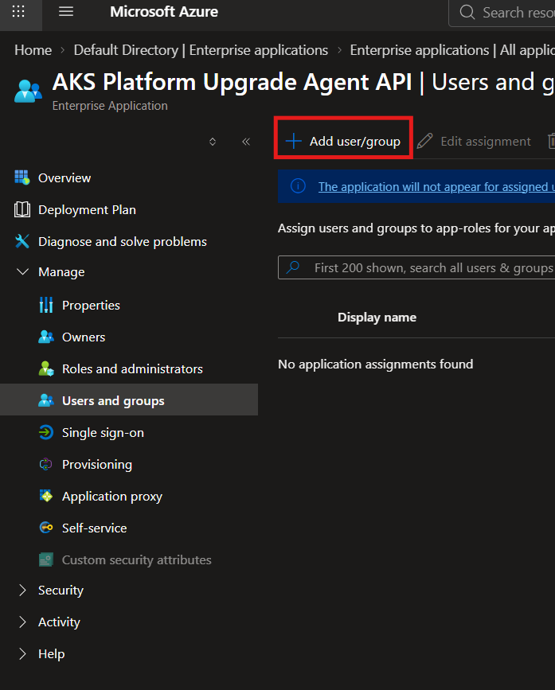


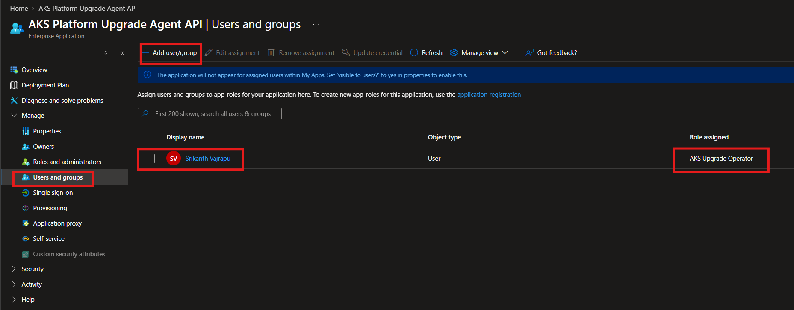


## Configure the frontend API variables

```
VITE_ENTRA_TENANT_ID=<YOUR_TENANT_ID>
VITE_ENTRA_CLIENT_ID=<YOUR_FRONTEND_CLIENT_ID>
VITE_API_SCOPE=api://<BACKEND_API_CLIENT_ID>/AKS.Upgrade
BACKEND_API_HOST=<YOUR_BACKEND_CONTAINER_APP_URL>
```
```
BACKEND_API_HOST=backend-api.internal.wittypond-14b25a6b.eastus.azurecontainerapps.io (no need to add https://)
```

## Configure the backend

The backend configuration in this project expects values such as:

```
APP_ENVIRONMENT=production
AUTH_MODE=entra_id
ENTRA_TENANT_ID=<YOUR_TENANT_ID>
ENTRA_AUDIENCE=api://<BACKEND_API_CLIENT_ID>
ENTRA_REQUIRED_ROLE=AKS.Upgrade.Operator
DATABASE_URL=<YOUR_POSTGRESQL_CONNECTION_STRING>
CORS_ALLOWED_ORIGINS=https://<YOUR_FRONTEND_CONTAINER_APP_URL>
```


### Deploy and validate the backend

* Build and publish the backend image.

* Deploy it to a separate Azure Container App.

* Configure its environment variables.

* Enable the appropriate ingress and networking.

* Ensure the frontend can reach the backend over HTTPS.

* Configure backend CORS to allow the exact frontend origin.

* Verify that the backend validates token signature, issuer, tenant, audience, expiry, and the required role.

* Test an authorized request and confirm that unauthorized requests are rejected.

* Only after these checks should you test AKS upgrade operations through the UI.


### Security and production recommendations

* Never put client secrets, database passwords, or other credentials in frontend code.

* Treat all VITE_* variables as public values because they are embedded in the browser bundle.

* Use HTTPS for the deployed frontend and backend.

* Limit access to upgrade operations through appropriate Entra roles and backend authorization.

* Restrict CORS to the exact frontend origins that need access.

* Use managed identity where appropriate for Azure resources and secure secret storage for credentials that cannot use managed identity.

* Do not rely on frontend-only controls to authorize backend operations.

* Keep the frontend and backend registrations separate.

* Rebuild the frontend image whenever build-time Vite configuration changes.